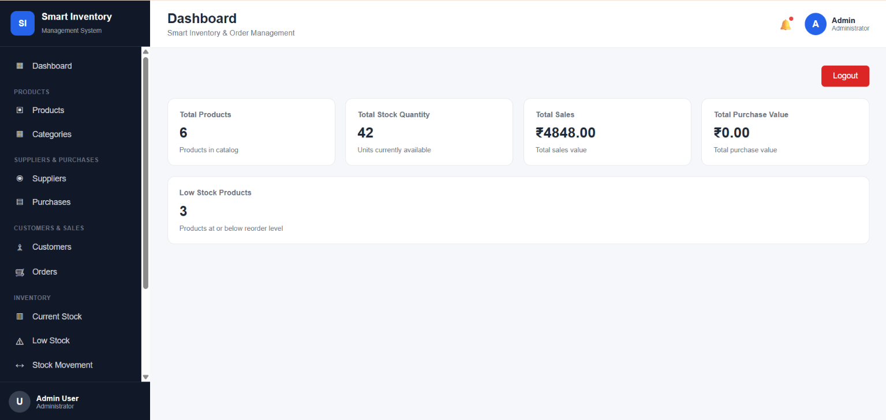
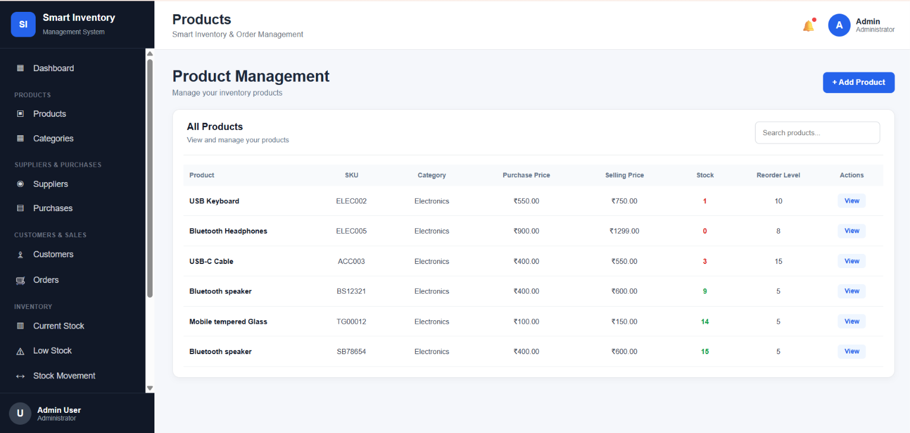
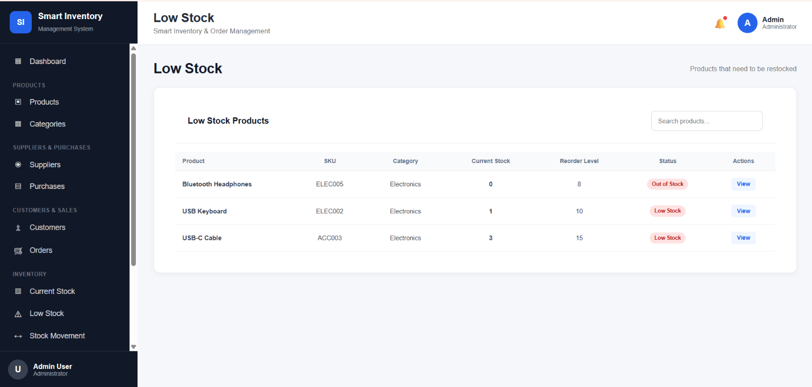
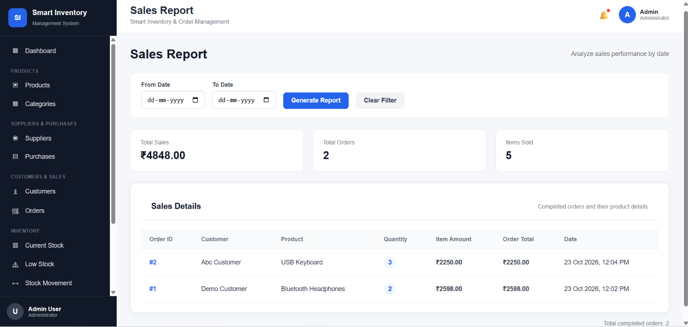

# Smart Inventory System

A web-based inventory management application built with Django and PostgreSQL to manage products, categories, suppliers, purchases, stock levels, customer orders, and inventory reports.

## Live Demo

- **Live Website:** [Smart Inventory System](https://smart-inventory-system-1u1q.onrender.com)
- **GitHub Repository:** [Smart Inventory System on GitHub](https://github.com/PraveenC1506/smart-inventory-system)

## Project Overview

The Smart Inventory System helps businesses manage inventory in one place. It provides a dashboard to view inventory information, manage product records, track stock movements, manage customer orders, and identify products that need restocking.

The application is built using Django with a web interface for inventory operations. It is deployed on Render and configured to use a PostgreSQL database hosted on Neon.

## Objectives

- Manage products and categories efficiently.
- Maintain supplier information.
- Record purchases and update stock quantities.
- Manage customer orders and track stock reductions.
- Monitor low-stock and out-of-stock products.
- View inventory reports and dashboard summaries.
- Provide authenticated access to the application.

## Features

### 1. Dashboard
- View total products and stock quantity.
- View sales and purchase summaries.
- Monitor low-stock products.

### 2. Product Management
- Add and manage product details.
- Maintain product names, SKUs, categories, prices, and stock quantities.
- Configure reorder levels for products.

### 3. Category Management
- Organize products into categories.
- Maintain product classification.

### 4. Supplier Management
- Maintain supplier information for inventory operations.

### 5. Purchase Management
- Record product purchases.
- Increase stock quantities when purchases are recorded.

### 6. Customer and Order Management
- Maintain customer information.
- Create and manage customer orders.
- Process orders and reduce stock quantities.
- Validate stock availability before reducing inventory.

### 7. Inventory and Stock Tracking
- View current stock levels.
- Identify low-stock and out-of-stock products.
- Track stock movements, including incoming, outgoing, and adjustment transactions.

### 8. Reports and Reorder Monitoring
- View inventory and stock reports.
- Review completed sales orders and sales summaries.
- Identify products that have reached their reorder levels.

### 9. Authentication and Settings
- Provide login and logout functionality.
- Restrict application access to authenticated users where configured.
- Manage application settings and user profile information.

### 10. REST API
- Provide API endpoints for product and category data.

## Screenshots

### 1. Dashboard

View total products, stock quantity, sales summary, purchase value, and low-stock products.



### 2. Product Management

Manage product names, SKUs, categories, purchase prices, selling prices, stock quantities, and reorder levels.



### 3. Low Stock Monitoring

Identify products that need restocking and distinguish low-stock products from out-of-stock products.



### 4. Sales Report

Review completed orders, total sales, items sold, customer details, and sales transactions.



## Technology Stack

| Component | Technology |
|---|---|
| Backend | Python, Django |
| Frontend | HTML, CSS, JavaScript |
| Database | PostgreSQL |
| Local development database | SQLite, when configured |
| Deployment | Render |
| Database hosting | Neon |
| Version control | Git and GitHub |

## System Requirements

- Python 3.10 or a compatible version supported by the project dependencies.
- pip
- Git
- Visual Studio Code or another code editor.
- PostgreSQL database, or a configured SQLite database for local development.
- A modern web browser.

## Installation and Setup

### 1. Clone the Repository

```bash
git clone https://github.com/PraveenC1506/smart-inventory-system.git
cd smart-inventory-system
```

### 2. Create a Virtual Environment

```bash
python -m venv venv
```

Activate the environment on Windows:

```powershell
venv\Scripts\activate
```

### 3. Install Dependencies

```bash
pip install -r requirements.txt
```

### 4. Configure Environment Variables

Create a `.env` file in the project root directory and configure the variables required by the Django settings.

Example:

```env
DJANGO_SECRET_KEY=replace-with-a-new-secret-key
DJANGO_DEBUG=True
DJANGO_ALLOWED_HOSTS=localhost,127.0.0.1
```

For PostgreSQL, configure a valid database connection using `NEON_DATABASE_URL` or `DATABASE_URL`, according to the project's settings.

Alternatively, configure the local database variables supported by the project:

```env
DB_NAME=smart_inventory_db
DB_USER=postgres
DB_PASSWORD=your-local-database-password
DB_HOST=localhost
DB_PORT=5432
```

Use the database configuration supported by your environment. Never commit real passwords, database URLs, or secret keys to GitHub. Keep `.env` excluded from version control.

### 5. Apply Database Migrations

```bash
python manage.py migrate
```

### 6. Create an Administrator Account

```bash
python manage.py createsuperuser
```

Follow the prompts to configure the administrator account.

### 7. Start the Development Server

```bash
python manage.py runserver
```

Open the following address in your browser:

[http://127.0.0.1:8000/](http://127.0.0.1:8000/)

## Deployment

The application is deployed using Render. The production database is hosted on Neon PostgreSQL.

Typical Render configuration:

**Build command**

```bash
pip install -r requirements.txt && python manage.py collectstatic --noinput && python manage.py migrate
```

**Start command**

```bash
gunicorn config.wsgi:application
```

Configure production environment variables in the Render dashboard. Set `DEBUG` to `False` in production and configure the appropriate allowed hosts, secret key, CSRF trusted origins, and database connection.

## Project Structure

The main project structure includes the following components:

```text
smart-inventory-system/
├── config/
│   ├── settings.py
│   ├── urls.py
│   └── wsgi.py
├── dashboard/
│   ├── models.py
│   ├── urls.py
│   ├── views.py
│   └── tests.py
├── inventory/
│   ├── models.py
│   ├── views.py
│   ├── urls.py
│   ├── api_urls.py
│   ├── api_views.py
│   ├── serializers.py
│   └── tests.py
├── screenshots/
│   ├── Dashboard.png
│   ├── Products.png
│   ├── Low_Stock.png
│   └── Reports.png
├── templates/
├── static/
├── manage.py
├── requirements.txt
├── .gitignore
└── README.md
```

## Testing

The inventory application test suite has previously passed with 23 tests, and Django's system check passed during development.

After making code changes, run:

```bash
python manage.py check
python manage.py test inventory
```

Verify the deployed application separately after deployment.

## Future Enhancements

- Barcode and QR-code-based inventory tracking.
- Email notifications for low-stock products.
- Advanced sales and inventory analytics.
- Exportable PDF and Excel reports.
- Role-based permissions for different staff members.
- Integration with billing and point-of-sale systems.

## Author

**Smart Inventory System — Project**

GitHub: [PraveenC1506](https://github.com/PraveenC1506)

## License

No license has been specified yet. Add a license if you intend to permit others to use, modify, or distribute this project.

